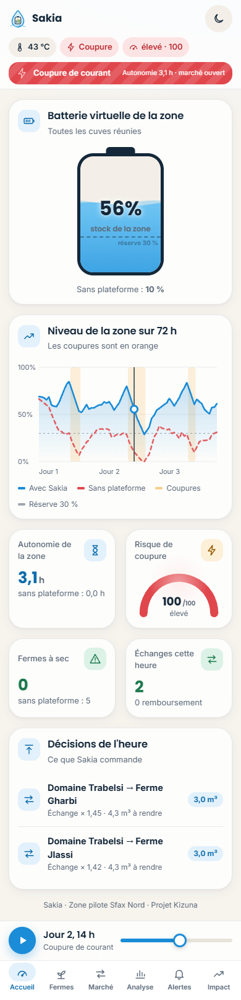
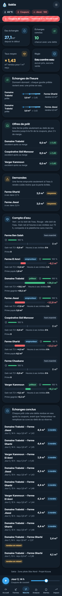
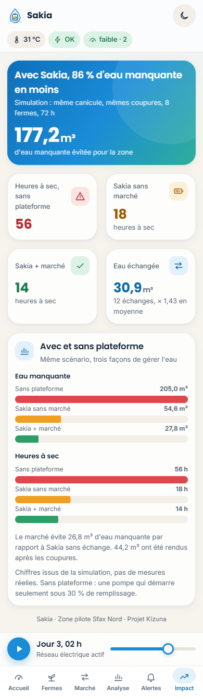
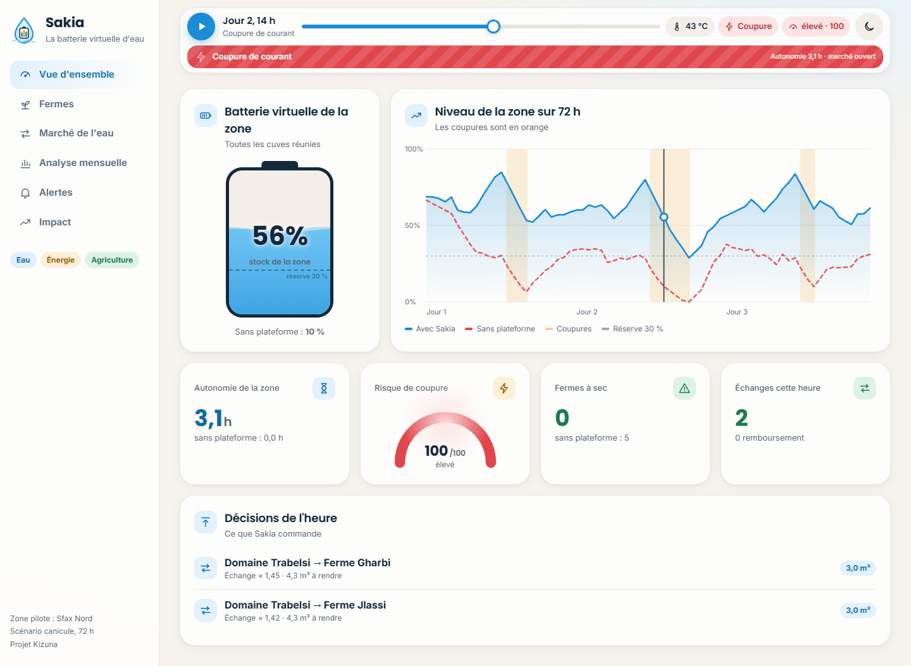

<p align="center"></p>

# Sakia · La batterie virtuelle d'eau

La *sakia* est le canal d'eau traditionnel des jardins et des oasis de Tunisie. Sakia fait la même chose avec les cuves d'une zone : elle répartit l'eau pour qu'elle soit là quand le courant coupe.

Projet né au hackathon Kizuna (Tunisie / Japon). Thème : eau, énergie et agriculture comme un seul système.

**Compatible mobile** : interface pensée d'abord pour le téléphone, puis adaptée à la tablette et à l'ordinateur. Elle s'installe sur l'écran d'accueil comme une application (manifest web, icônes, mode sombre).

<p align="center">
  
  
  
</p>

## Problème
Pendant une canicule, le réseau électrique coupe, les pompes s'arrêtent, les robinets sèchent et les agriculteurs perdent leur eau.

## Idée
Les cuves de toutes les fermes d'une zone forment une **batterie virtuelle d'eau**. Elle ne stocke pas de l'électricité, elle stocke du service : de l'eau prête à servir pendant une coupure.

- Autonomie de la zone en heures, avec 30 % de réserve minimale
- Risque de coupure (chaleur, coupures annoncées, signalements, heures de pointe)
- Décision de pompage : remplir avant la coupure, pas après
- Marché de l'eau entre voisins : eau contre eau, jamais d'argent
- Priorités quand l'énergie de secours est limitée : eau potable et bétail d'abord
- Alertes WhatsApp et SMS
- Analyse mensuelle de l'électricité et de l'eau, anomalies (fuite de nuit, saut de consommation) et conseils
- Rapport d'impact : avec et sans plateforme

## Marché de l'eau
Chaque ferme agit pour son propre intérêt. Un échange n'a lieu que si les deux fermes y gagnent.

- **Prêteur** : il prête seulement ce qui dépasse ses propres besoins jusqu'à la fin prévue de la coupure, plus 2 h de marge de sécurité.
- **Emprunteur** : il emprunte seulement si l'eau à rendre coûte moins que la perte évitée. La valeur d'1 m³ manquant dépend de la priorité : eau potable et bétail (×3), cultures fragiles (×2), arbres (×1,2). Les arbres empruntent donc rarement.
- **Taux dynamique** : pour 1 m³ reçu, l'emprunteur rend entre 1,1 et 1,5 m³. Le taux monte avec le risque de coupure, la durée restante de la coupure et la baisse de l'excédent du prêteur.
- **Mise en relation** : les offres au meilleur taux sont associées aux demandes les plus urgentes (heures avant d'être à sec, puis priorité).
- **Compte d'eau** : chaque prêt crée une dette (volume, taux, échéance 6 h après la coupure). Après la coupure, une ferme endettée remplit d'abord sa réserve de 30 %, puis rembourse, et seulement ensuite remplit le reste de sa cuve.
- **Fiabilité** : chaque heure de retard fait baisser le score, ce qui augmente le taux proposé à la ferme. Une ferme trop endettée (dette supérieure à 50 % de sa cuve) ou peu fiable (moins de 50 %) voit sa demande refusée.
- **Pas d'argent** : l'eau est un bien public en Tunisie et sa revente est un sujet sensible. Le marché n'a aucun prix en dinars, seulement de l'eau rendue en eau.

## Lancer
```
pip install -r requirements.txt
python -m uvicorn backend.main:app --port 8000
```
Ouvrir http://localhost:8000. Tests : `python -m pytest`.

## Interface
- HTML, CSS et JavaScript simples (modules ES), sans framework ni étape de build.
- `app/css/` : `tokens.css` (couleurs, rayons, ombres, espacements, tailles de texte, durées et courbes d'animation, thème sombre), `base.css` (mise en page), `components.css`, `motion.css`.
- `app/js/` : `main.js` (navigation, thème, lecture sur 72 h), `views.js` (les six vues), `charts.js` (batterie, cuves, jauge, graphiques SVG), `icons.js`, `dom.js`.
- Téléphone : navigation fixe en bas, barre de lecture du temps juste au-dessus, zones cliquables de 44 px, zones sûres (encoche, barre du bas) prises en compte. Ordinateur : barre latérale.
- Mode sombre : bouton dans l'en-tête, choix mémorisé dans le navigateur, réglage du système respecté par défaut.
- Animations : transitions entre vues, cartes en cascade, compteurs, eau qui monte avec une vague, courbe qui se dessine, jauge de risque, bandeau de coupure, gouttes qui circulent entre fermes. Elles sont coupées si `prefers-reduced-motion` est activé.
- Lien direct vers une vue et une heure : `http://localhost:8000/?h=38#/market`.

## Captures d'écran
Chaque vue est capturée en 390×844 (téléphone), 820×1180 (tablette) et 1440×900 (ordinateur), en clair et en sombre : `docs/screens/<vue>-<appareil>-<thème>.png`.

| Vue | Téléphone | Tablette | Ordinateur |
|---|---|---|---|
| Vue d'ensemble | [clair](docs/screens/overview-mobile-light.png) · [sombre](docs/screens/overview-mobile-dark.png) | [clair](docs/screens/overview-tablet-light.png) · [sombre](docs/screens/overview-tablet-dark.png) | [clair](docs/screens/overview-desktop-light.png) · [sombre](docs/screens/overview-desktop-dark.png) |
| Fermes | [clair](docs/screens/farms-mobile-light.png) · [sombre](docs/screens/farms-mobile-dark.png) | [clair](docs/screens/farms-tablet-light.png) · [sombre](docs/screens/farms-tablet-dark.png) | [clair](docs/screens/farms-desktop-light.png) · [sombre](docs/screens/farms-desktop-dark.png) |
| Marché de l'eau | [clair](docs/screens/market-mobile-light.png) · [sombre](docs/screens/market-mobile-dark.png) | [clair](docs/screens/market-tablet-light.png) · [sombre](docs/screens/market-tablet-dark.png) | [clair](docs/screens/market-desktop-light.png) · [sombre](docs/screens/market-desktop-dark.png) |
| Analyse mensuelle | [clair](docs/screens/analysis-mobile-light.png) · [sombre](docs/screens/analysis-mobile-dark.png) | [clair](docs/screens/analysis-tablet-light.png) · [sombre](docs/screens/analysis-tablet-dark.png) | [clair](docs/screens/analysis-desktop-light.png) · [sombre](docs/screens/analysis-desktop-dark.png) |
| Alertes | [clair](docs/screens/alerts-mobile-light.png) · [sombre](docs/screens/alerts-mobile-dark.png) | [clair](docs/screens/alerts-tablet-light.png) · [sombre](docs/screens/alerts-tablet-dark.png) | [clair](docs/screens/alerts-desktop-light.png) · [sombre](docs/screens/alerts-desktop-dark.png) |
| Impact | [clair](docs/screens/impact-mobile-light.png) · [sombre](docs/screens/impact-mobile-dark.png) | [clair](docs/screens/impact-tablet-light.png) · [sombre](docs/screens/impact-tablet-dark.png) | [clair](docs/screens/impact-desktop-light.png) · [sombre](docs/screens/impact-desktop-dark.png) |



## Structure
- `simulator/` scénario de canicule sur 72 h, 8 fermes
- `backend/engine.py` risque, autonomie, décisions, marché de l'eau, anomalies
- `backend/db.py` base SQLite (fermes, mesures, alertes, compte d'eau, stats mensuelles)
- `backend/main.py` API FastAPI (`/api/simulation`, `/api/analysis`, `/api/ingest`)
- `app/` tableau de bord web Sakia (voir « Interface »)
- `firmware/esp32_node/` code ESP32 optionnel qui envoie le niveau de cuve à `/api/ingest`
- `docs/screens/` captures d'écran

## Résultat de la simulation
Ce sont des chiffres de simulation (même canicule, mêmes coupures, 8 fermes, 72 h), pas des mesures réelles.

| Scénario | Eau manquante | Heures à sec (fermes × heures) |
|---|---|---|
| Sans plateforme (pompe qui démarre sous 30 %) | 205,0 m³ | 56 |
| Plateforme, sans marché | 54,6 m³ | 18 |
| Plateforme + marché de l'eau | 27,8 m³ | 14 |

- Environ 86 % d'eau manquante en moins avec la plateforme et le marché.
- Le marché seul évite 26,8 m³ d'eau manquante par rapport à la plateforme sans échange.
- 12 échanges, 30,9 m³ prêtés, taux moyen ×1,43, 44,2 m³ rendus après les coupures.
- Toutes les fermes qui échangent ont un gain net positif en m³. Les prêteurs gagnent la prime, et les emprunteurs évitent un manque d'eau supérieur à la prime payée.

## Matériel (optionnel)
ESP32, capteur ultrason étanche, débitmètre YF-S201, INA219, relais, mini pompe DC, mini panneau solaire.
